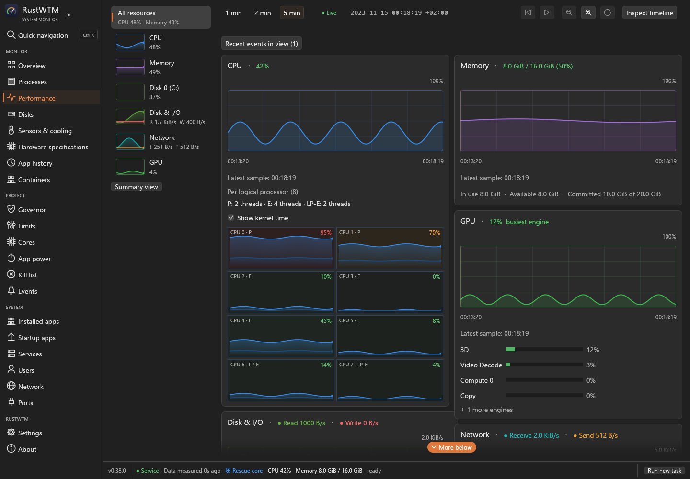

<p align="center">
  
</p>

<h1 align="center">RustWTM</h1>

A Windows task manager and resource governor written in Rust. Inspect what
your PC is doing, diagnose slowdowns, and apply resource policies in the
background. The governor starts in dry-run mode so you can review its
decisions before turning on enforcement.

[Website](https://rustwtm.com) · [Downloads](https://github.com/rustwtm/rustwtm/releases/latest) ·
[Changelog](CHANGELOG.md) · [Issues](https://github.com/rustwtm/rustwtm/issues)

[](https://github.com/rustwtm/rustwtm/actions/workflows/ci.yml)
[](LICENSE)
[](https://github.com/rustwtm/rustwtm/releases/latest)



[Process workspace](screenshots/processes.png) · [Compact layout](screenshots/processes-compact.png) ·
[More screenshots](docs/screenshots.md)

## Install

RustWTM supports 64-bit Windows 10 1809 or later and Windows 11. Download the versioned
MSI from [GitHub Releases](https://github.com/rustwtm/rustwtm/releases/latest).
The MSI requests administrator approval, installs to `C:\Program Files\RustWTM`,
and starts the governor service. To run the app without installing a service,
extract the release ZIP and open `rustwtm.exe`.

[Verify a download, use the install script, or uninstall](docs/installation.md).

## What you can do

- **Inspect processes.** Switch between a list, tree and app groups. Inspect
  threads, handles, modules, memory maps, hosted services and wait chains.
  [Process workspace](docs/process-workspace.md) · [Inspection guide](docs/process-inspection.md)
- **Diagnose usage.** Follow CPU, memory, GPU, disk and network activity,
  inspect historical samples, and see which processes own listening ports.
  [Performance timeline](docs/performance-timeline.md) · [Sampling and limits](docs/performance-resources.md)
- **Protect responsiveness.** Preview CPU throttling, per-app budgets, rules
  and optional working-set trimming before enabling enforcement.
  [Configuration](docs/configuration.md) · [Memory Guard measurements](docs/memory-guard.md)
- **Place apps on cores.** Keep an app on chosen cores, keep apps apart
  while they run together, or reserve cores for one app.
  [Core placement](docs/core-placement.md)
- **Power while an app runs.** Switch to a power plan and keep the computer
  awake while a render or a call runs; the previous plan comes back after.
  [App power](docs/app-power.md)
- **Manage Windows and local workloads.** Review startup entries, services,
  installed apps and packages, inspect disk usage and monitor local Docker
  containers. [Installed apps](docs/inventory-app-management.md) · [Docker](docs/docker.md)
- **Monitor hardware.** Read temperatures, power, fan RPM and clocks where the
  provider supports them. Compatible devices can use opt-in fan curves.
  [Hardware setup and validation](docs/hardware.md) · [CPU controls](docs/cpu-controls.md)
- **Use integrations.** The optional Telegram bot reports from allowed chats.
  Use the CLI's local MCP server or configure a per-user AI provider for
  reviewed diagnostic requests. [Telegram](docs/telegram.md) · [CLI, MCP and AI](docs/usage.md#cli)

## Get started

Open **RustWTM** from the Start Menu. Right-click a process to see available
actions. Review **Events** before turning on automation in **Settings**.
The optional [Ctrl+Shift+Esc integration](docs/task-manager.md) lets an
administrator choose RustWTM as the Windows Task Manager entry point.

```powershell
wtm list --sort mem -n 20
wtm ports --known
wtm sensors --json
wtm config show
```

The service reads `%ProgramData%\RustWTM\config.toml`. Save changes from an
elevated app or validate and apply them with `wtm config check` and
`wtm config apply`. [Configuration reference](docs/configuration.md)

## Architecture

| Crate | Purpose |
|---|---|
| `wtm-sys` | Safe Win32 and NT API wrappers, the workspace's only `unsafe` crate |
| `wtm-core` | Windows sampling, inspection, process controls and inventory |
| `wtm-policy` | Policy decisions, rule evaluation, settings and historical analysis |
| `wtm-ipc` | Local named-pipe protocol and client |
| `wtm-service` | Windows governor, executor, history and privileged request handlers |
| `wtm-ai` | Per-user AI provider settings, request construction and adapters |
| `wtm-gui` | egui desktop app (`rustwtm.exe`) |
| `wtm-cli` | CLI and local stdio MCP server (`wtm.exe`) |

The service runs as LocalSystem. Local pipe control requests require an
elevated administrator and process detail queries run with the caller's
rights. [Security policy and privilege boundaries](SECURITY.md)

## Development

```powershell
cargo build --locked --workspace
cargo fmt --all -- --check
cargo clippy --workspace --all-targets -- -D warnings
cargo test --workspace
```

The toolchain is pinned in `rust-toolchain.toml`. For the optional hardware
helper, see the [build instructions](docs/hardware.md).

[Contributing](CONTRIBUTING.md) · [Roadmap](docs/product-roadmap.md) ·
[Release notes and reviews](CHANGELOG.md) · [Display settings](docs/display-preferences.md) ·
[Language support](docs/localization.md)

## License

[MIT](LICENSE). Maintained by [OXOGNET OÜ](https://oxog.net), Estonia.
See [MAINTAINERS.md](MAINTAINERS.md) for contact details.
